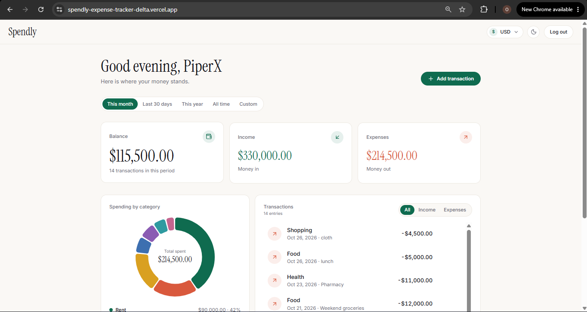
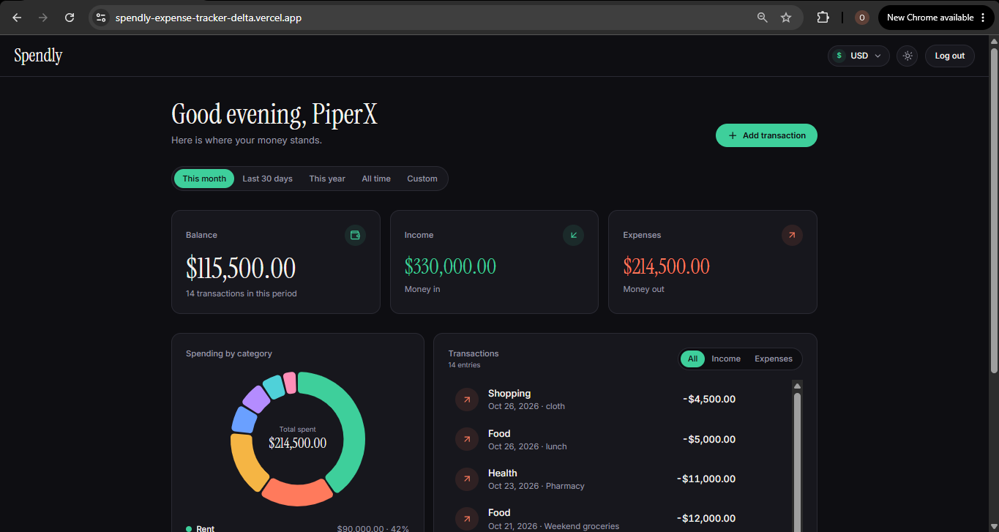

# Spendly

Spendly is a full-stack expense and budget tracker. Log your income and spending, and see your balance, where your money goes by category, and every transaction in one live dashboard.

**Live demo:** https://spendly-expense-tracker-delta.vercel.app

**Want a quick look?** Open the link and click **Try the demo**. It gives you a private dashboard full of sample data in one click, with no sign-up.

> The API runs on a free hosting tier, so the first request after a quiet period can take up to a minute while the server wakes up.





## Features

- One-click demo: every visitor gets a private account with 36 sample transactions, which deletes itself after 24 hours
- Sign up and log in with hashed passwords and JWT authentication
- Add, edit and delete income and expense transactions (amount, category, date, note)
- Summary of balance, total income, total expenses and spending by category
- Animated donut chart and category breakdown
- Date filters: this month, last 30 days, this year, all time and custom range
- Currency switcher with 10 currencies, defaulting from the browser language
- Light and dark themes
- Responsive layout with smooth, reduced-motion-friendly animations

## Tech stack

| Layer | Tools |
|---|---|
| Frontend | React, TypeScript, Vite, Tailwind CSS, Motion, Recharts |
| Backend | Node.js, Express, TypeScript |
| Database | MongoDB Atlas with Mongoose |
| Auth | JWT, bcrypt |
| Hosting | Vercel (client), Render (API), MongoDB Atlas (database) |

## How it works

1. A user signs up or logs in. The API hashes the password with bcrypt, stores the user in MongoDB and returns a signed JWT.
2. The React app keeps the token and sends it with every request.
3. A middleware verifies the token and every query is filtered by the user's id, so people only ever see their own data.
4. The summary endpoint adds up income and expenses in the database with an aggregation, and the dashboard animates the results.
5. Demo accounts are created on request with sample data and an expiry time. A MongoDB TTL index removes them after 24 hours, and the demo endpoint is rate limited per IP.

## API

| Method | Endpoint | Description |
|---|---|---|
| POST | `/api/auth/register` | Create an account |
| POST | `/api/auth/login` | Log in |
| POST | `/api/auth/demo` | Start a private, self-expiring demo account |
| GET | `/api/auth/me` | Get the current user |
| GET | `/api/transactions` | List transactions (`from`, `to`, `type` filters) |
| POST | `/api/transactions` | Add a transaction |
| PUT | `/api/transactions/:id` | Edit a transaction |
| DELETE | `/api/transactions/:id` | Delete a transaction |
| GET | `/api/summary` | Balance, income, expenses and spending by category (`from`, `to` filters) |
| GET | `/api/health` | Health check |

All routes except register, login, demo and health require a `Bearer` token.

## Run it locally

You need Node.js and a free MongoDB Atlas cluster.

```bash
git clone https://github.com/opiper21/spendly-expense-tracker.git
cd spendly-expense-tracker
```

**API**

```bash
cd server
npm install
cp .env.example .env
```

Fill in `.env` with your MongoDB connection string and a long random `JWT_SECRET`, then:

```bash
npm run dev
```

**Client** (in a second terminal)

```bash
cd client
npm install
cp .env.example .env
npm run dev
```

The client runs on `http://localhost:5173` and expects the API on `http://localhost:5001`.

## Project structure

```
spendly/
  client/   React + TypeScript + Tailwind app
  server/   Express + TypeScript API
  docs/     Screenshots
```

## Roadmap

- Forgot password and email confirmation on signup
- Budgets per category and recurring transactions
- CSV import and export
- httpOnly cookie sessions and security headers
- Automated tests

## Author

Built by PiperX. [GitHub](https://github.com/opiper21)